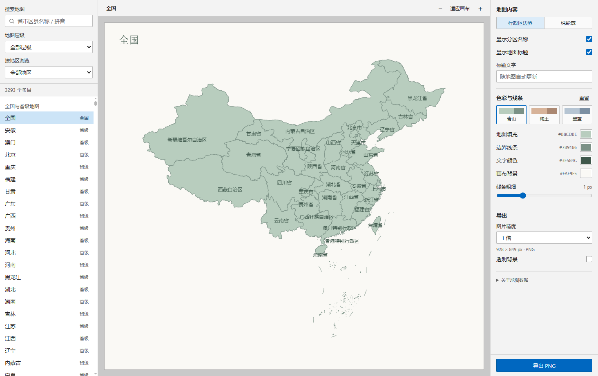

# Urbis · 江城子

江城子是一款离线地图桌面应用，用于浏览全国、省、市和区县地图，自定义地图样式并导出图片。

内置 3,293 个地图条目，包含全国地图、34 个省级、368 个城市层及 2,890 个区县层条目。



## 功能

- 点击地图逐级进入下一级，或通过中文、拼音和首字母搜索地区。
- 切换行政区地图与纯轮廓，支持拖动和缩放。
- 青山、陶土、墨蓝三种配色，也可自定义填充、线条和文字颜色，设置线宽、地名和标题。
- 导出 1–4 倍高清 PNG 图片，支持透明背景。
- 完全离线使用，自动记住上次选择的地图和样式。
- 支持 Windows 10 / 11 与 macOS。

## 下载

最新版本为 [v1.0.0](https://github.com/lkimuk/urbis/releases/tag/v1.0.0)，历史版本见 [Releases](https://github.com/lkimuk/urbis/releases) 页面。

| 平台                   | 安装包                                                                                                                          | 说明                                          |
| ---------------------- | ------------------------------------------------------------------------------------------------------------------------------- | --------------------------------------------- |
| Windows 10 / 11（x64） | [Urbis-1.0.0-windows-x64-setup.exe](https://github.com/lkimuk/urbis/releases/download/v1.0.0/Urbis-1.0.0-windows-x64-setup.exe) | NSIS 安装包，可选择安装目录并创建桌面快捷方式 |
| macOS（Apple Silicon） | [Urbis-1.0.0-mac-arm64.dmg](https://github.com/lkimuk/urbis/releases/download/v1.0.0/Urbis-1.0.0-mac-arm64.dmg)                 | 适用于 M1 及之后的芯片                        |
| macOS（Intel）         | [Urbis-1.0.0-mac-x64.dmg](https://github.com/lkimuk/urbis/releases/download/v1.0.0/Urbis-1.0.0-mac-x64.dmg)                     | 适用于 Intel 芯片                             |

安装包未配置代码签名，首次运行需要手动放行：Windows 如提示“已保护你的电脑”，选择“更多信息 → 仍要运行”；macOS 请右键点击应用图标选择“打开”，或在“系统设置 → 隐私与安全性”中允许。

## 开发

需要 Node.js 22.12 或更高版本，首次安装依赖时需要联网，运行应用本身无需联网。

```bash
npm ci
npm start
```

`npm test` 运行单元测试，`npm run smoke` 在独立的临时会话中执行界面冒烟测试，截图与报告写入 `artifacts/`。打包使用 `npm run dist`（Windows 安装包）或 `npm run dist:mac`（macOS DMG），产物输出到 `release/`。

## 许可

[MIT](LICENSE)
